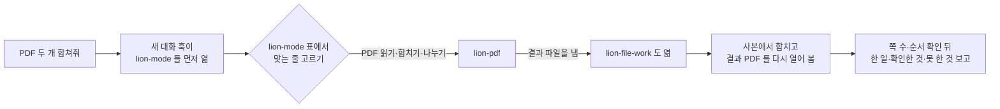
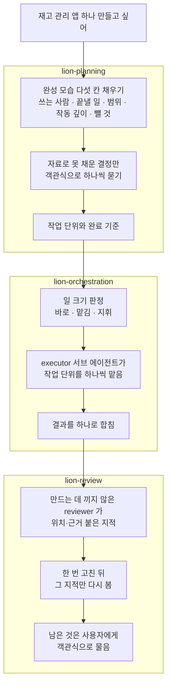
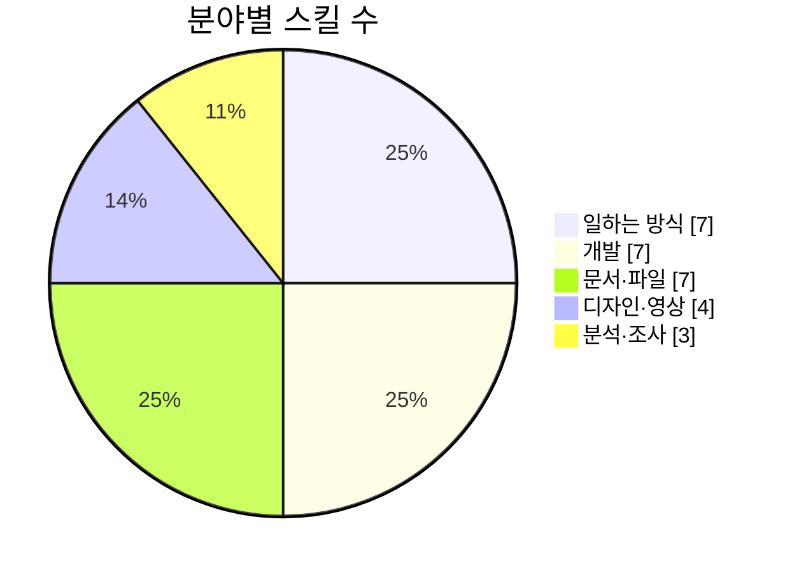

# lion 스킬

Claude Code 와 Codex 에서 쓰는 한국어 작업 스킬 28개와 역할 에이전트 5개를 모은 저장소다.

새 대화를 시작하면 길잡이 스킬 `lion-mode` 가 먼저 열린다. `lion-mode` 는 요청에 맞는 스킬을 자기 표에서 고르고, 그 스킬의 `SKILL.md` 를 읽은 뒤 작업을 시작한다. "PDF 두 개 합쳐줘", "로그인하면 흰 화면만 나와", "이 카톡 답장 다듬어줘"처럼 평소 쓰는 말로 요청한다. 스킬 이름을 따로 부를 필요는 없다.

스킬 본문과 열림 문구는 모두 한국어다. Windows 11 의 Claude Code 2.1 과 Codex CLI 0.157 에서 설치와 첫 대화를 시험했다.

## 요청 하나가 처리되는 순서

"PDF 두 개 합쳐줘" 를 보내면 다음 순서로 처리한다.



각 스킬의 「함께 여는 스킬」 절에는 함께 읽을 스킬 이름이 적혀 있다. `lion-pdf`·`lion-hangul`·`lion-spreadsheet` 는 결과 파일을 만들 때 `lion-file-work` 를 함께 연다. `lion-file-work` 는 원본을 보존하고 사본을 수정한다. 저장한 파일은 다시 열어 수정 대상 밖의 쪽·서식·값이 그대로인지 확인한다.

## 큰 작업의 기획·분담·검수

"재고 관리 앱 하나 만들고 싶어"처럼 만들 것부터 정해야 하는 요청은 기획, 작업 분담, 최종 검수 순서로 간다.



이 과정에서 역할 에이전트 5개를 쓴다. `scoper` 는 기획을, `planner` 는 계획을 맡는다. `executor` 는 작업을 실행하고 `reviewer` 는 결과를 검수한다. 긴 로그·저장소 전체·외부 문서 읽기는 `researcher` 가 맡는다. 모델과 추론 노력은 호출할 때 작업에 맞춰 고른다. 에이전트 파일에는 고정해 두지 않는다.

## 스킬 목록



### 일하는 방식

| 스킬 | 맡는 일 | 이런 말에 열린다 |
|---|---|---|
| `lion-mode` | 길잡이. 요청에 맞는 스킬 선택. 자동으로 열리는 유일한 스킬 | 할 일이 있는 요청 전부 |
| `lion-planning` | 완성 모습 정의, 사용자에게 물을 결정 정리, 작업 순서 수립 | "재고 관리 앱 하나 만들고 싶어", "뭐부터 해야 해?" |
| `lion-orchestration` | 작업 크기 판단, 서브 에이전트에 작업 분담, 서브 에이전트의 모델·추론 노력 선택 | "병렬로 돌려", "로그 너무 길어, 서브한테 맡겨서 원인만 뽑아와" |
| `lion-review` | 작업 완료 후 검수 한 번과 재검토 한 번 | "검토해줘", "다 만든 거 요구한 대로 됐는지 확인해줘" |
| `lion-project-rules` | 프로젝트 규칙 문서(AGENTS.md)·결정 기록·작업 이어 하기·다음 세션 인계 | "새 프로젝트인데 규칙부터 잡아줘", "어디까지 했지? 이어서 해줘" |
| `lion-skill-update` | 스킬 생성·수정·통합, 호출 시험, Claude·Codex 설치본 맞추기 | "이걸 스킬로 만들어줘", "스킬이 자꾸 안 불려, 설명 고쳐줘" |
| `lion-bro` | 이해하기 어려운 답을 결론 한 문장과 실제 예로 다시 설명 | "브로", "뭔 소리야?" |

### 개발

| 스킬 | 맡는 일 | 이런 말에 열린다 |
|---|---|---|
| `lion-app-development` | 앱 기능·화면·API·데이터·설정 생성과 수정 | "버튼 하나 추가해줘", "엑셀 내보내기 기능 넣어줘" |
| `lion-tauri` | Tauri 2 앱의 IPC 권한·CSP·플러그인·자동 업데이트·설치판·WebView2 | "updater 붙여서 자동 업데이트 되게 해줘", "tauri 2.11 로 올려줘" |
| `lion-debugging` | 오류·실패·속도 저하의 원인 분석과 수정, 지난 로그 판독 | "로그인하면 흰 화면만 나와", "어젯밤에 왜 멈췄는지 로그 좀 봐줘" |
| `lion-testing` | 테스트 케이스·회귀 시험·버그 판정·QA 보고서 | "테스트 케이스 짜줘", "이거 버그야 아니야?" |
| `lion-app-verification` | 앱을 실행하고 사용자처럼 조작하며 확인하는 절차 문서 작성 | "이 앱 확인하는 절차 만들어줘" |
| `lion-release` | 커밋·PR·빌드·배포·설치 파일·소스 인계 | "푸시하고 PR 올려줘", "설치 파일 만들어줘" |
| `lion-dev-checks` | 패키지 추가, 실행용 bat, 수정 전후 속도 비교, 실패한 시험을 통과하도록 수정 | "axios 패키지 추가해줘", "고치기 전이랑 후 속도 재서 비교해줘" |

### 문서·파일

| 스킬 | 맡는 일 | 이런 말에 열린다 |
|---|---|---|
| `lion-document` | Word·Markdown·텍스트·EPUB 형식의 보고서·회의록·제안서 | "월간 업무 보고서 워드로 써줘", "이 마크다운 epub으로 바꿔줘" |
| `lion-writing-polish` | AI 티 제거와 문장 다듬기. 고치기 전에 AI 티 비율을 잰다 | "AI 티 빼줘", "이 카톡 답장 너무 AI 같아" |
| `lion-spreadsheet` | 엑셀·CSV·TSV 표 생성·수정·분석 | "이 CSV 합계 내줘", "수식 오류 고쳐줘" |
| `lion-ppt` | PPT·HTML 발표 슬라이드 | "발표 자료 만들어줘", "PPT 10장으로 줄여줘" |
| `lion-pdf` | PDF 읽기·합치기·나누기·수정, 스캔본 글자 인식 | "PDF 합쳐줘", "스캔본 글자 인식해줘" |
| `lion-hangul` | 한글 HWP·HWPX 문서 | "hwp를 pdf로 바꿔줘", "한글 양식에 내용 채워줘" |
| `lion-file-work` | 형식 변환, 여러 파일 일괄 처리, 이전 서식 재사용. 원본을 보존하고 결과를 다시 열어 확인 | "이 폴더 문서 30개 한꺼번에 이름 바꿔줘", "원본은 두고 사본에서 고쳐줘" |

### 디자인·영상

| 스킬 | 맡는 일 | 이런 말에 열린다 |
|---|---|---|
| `lion-production` | 제작 전 요청서, 디자인 질문지, 시안 비교, 사용할 프로그램 점검, 디자인 틀 목록 | "발표자료 들어가기 전에 시안 3개 먼저 비교하자" |
| `lion-video` | 쇼츠·설명 영상·모션그래픽 제작, 자막·편집·재렌더링 | "이 대본으로 30초 쇼츠 만들어줘", "영상 7초쯤 문구 바꾸고 다시 렌더해줘" |
| `lion-visual-design` | 로고·브랜드 색·아이콘·배너·포스터 | "로고 만들어줘", "인스타 이미지 3종 뽑아줘" |
| `lion-visual-explain` | 개념을 한 페이지 그림(HTML)으로 설명 | "토큰이 뭔지 5살도 알게 설명해줘", "eli5 DNS" |

### 분석·조사

| 스킬 | 맡는 일 | 이런 말에 열린다 |
|---|---|---|
| `lion-security` | 보안 점검, 권한·인증, 코드에 직접 넣은 키, 주입, 업로드 검사 | "이거 해킹당할 구멍 없어?", "API 키가 코드에 박혀 있는지 봐줘" |
| `lion-ai-evaluation` | AI 기능 품질 평가, 모델·프롬프트 비교 | "요약 기능에 어느 모델 쓸지 비교해줘", "AI가 뽑은 값 그대로 저장해도 돼?" |
| `lion-research` | 공식 문서·원문 등 1차 출처 조사, 출처별 날짜와 사실·추론 표시 | "출처 달아서 알려줘", "기사마다 숫자가 다른데 어느 게 맞아?" |

## 어느 스킬을 열든 지키는 것

`lion-mode` 는 선택한 스킬과 함께 아래 규칙을 읽도록 한다.

- 요청이 길거나 자료를 여러 개 붙여 넣었으면 첫 답변 맨 앞에 이해한 목표를 한두 문장으로 쓴다.
- "할까?", "넣을까?"라고 물으면 실행 여부를 판단해 답한다. 들일 수고에 비해 얻는 것이 적으면 하지 말자는 의견과 이유를 전한다.
- 완료 보고는 결과부터 쓴다. 각 주장이 확인한 사실인지 추정인지 밝히고 링크·숫자·경로는 이번 작업에서 실제로 만들거나 읽은 것만 쓴다.
- 요청 범위 밖에서 자료 손실, 잘못된 계산, 보안 취약점을 발견하면 완료 보고 첫머리에 쓴다.

## 설치

### Claude Code

1. 터미널에서 두 줄을 차례로 실행한다.
   ```
   claude plugin marketplace add lionsd-sms/lion-skills
   claude plugin install lion@lion-skills
   ```
2. 파일 읽기 권한을 추가한다. `lion-mode` 는 선택한 스킬의 `SKILL.md` 를 파일로 읽는다. 아래 설정이 없으면 읽을 때마다 권한 승인 창이 뜬다. 플러그인은 이 권한을 직접 추가하지 못하므로 `%USERPROFILE%\.claude\settings.json`(macOS·Linux 는 `~/.claude/settings.json`)의 `permissions.allow` 에 한 줄을 추가한다.
   ```json
   "Read(~/.claude/plugins/cache/lion-skills/**)"
   ```
   settings.json 이 없으면 아래 내용으로 새로 만든다.
   ```json
   {
     "permissions": {
       "allow": ["Read(~/.claude/plugins/cache/lion-skills/**)"]
     }
   }
   ```
3. Claude Code 를 다시 시작한다.
4. 새 대화에서 `PDF 두 개 합쳐줘` 를 입력한다. 첫 동작으로 `lion:lion-mode` 가 열리고 권한 승인 창 없이 `skills/lion-pdf/SKILL.md` 를 읽는지 확인한다.

### Codex

1. 터미널에서 두 줄을 차례로 실행한다.
   ```
   codex plugin marketplace add lionsd-sms/lion-skills
   codex plugin add lion@lion-skills
   ```
2. Codex 새 대화에서 `/hooks` 를 열고 lion 플러그인의 SessionStart 훅을 신뢰하도록 설정한다. Codex 는 신뢰한 플러그인 훅만 실행한다. 이 훅이 실행되어야 `lion-mode` 가 먼저 열린다.
3. 역할 에이전트를 쓰려면 `extras/codex-agents/` 의 파일 5개를 `%USERPROFILE%\.codex\agents\`(macOS·Linux 는 `~/.codex/agents/`)에 복사한다. Codex 플러그인은 에이전트 포함을 지원하지 않아 별도로 복사한다. 플러그인을 깔면 이 폴더가 `~/.codex/plugins/cache/lion-skills/lion/<판 번호>/extras/codex-agents/` 에 함께 내려온다.
4. 새 대화에서 `PDF 두 개 합쳐줘` 를 입력한다. `lion-mode` 다음에 `lion-pdf` 의 `SKILL.md` 를 읽는지 확인한다.

### 전역 규칙 (선택 사항)

`extras/global-rules/` 의 `CLAUDE.md`(Claude)와 `AGENTS.md`(Codex)는 제작자가 모든 프로젝트에 적용하는 규칙이다. 되돌리기 어려운 작업 전 복구 기준점 생성, 설명에 아스키 그림 사용, 세션 제목 형식 등이 들어 있다.

같이 쓰려면 `~/.claude/CLAUDE.md` 나 `~/.codex/AGENTS.md` 끝에 붙여 넣는다. 스킬은 이 규칙 없이도 작동한다.

## 새 판 받기

```
claude plugin marketplace update lion-skills
claude plugin update lion@lion-skills
```

```
codex plugin marketplace upgrade lion-skills
codex plugin add lion@lion-skills
```

판마다 바뀐 내용은 [CHANGELOG.md](CHANGELOG.md) 에 적는다.

## 지우기

- Claude Code: `claude plugin uninstall lion@lion-skills` 다음 `claude plugin marketplace remove lion-skills` 를 실행한다. settings.json 에 추가한 읽기 권한 줄도 지운다.
- Codex: `codex plugin remove lion@lion-skills` 다음 `codex plugin marketplace remove lion-skills` 를 실행한다. 복사한 역할 에이전트 5개도 지운다.
- 전역 규칙을 붙여 넣었으면 그 부분을 지운다.

## 폴더 구조

```
lion-skills/
├─ .claude-plugin/            Claude 가 읽는 설정 (plugin.json · marketplace.json)
├─ .codex-plugin/             Codex 가 읽는 설정 (plugin.json)
├─ .agents/plugins/           Codex 마켓플레이스 목록 (marketplace.json)
├─ skills/                    스킬 28개. 두 AI 가 같은 폴더를 읽는다
│  └─ lion-pdf/
│     ├─ SKILL.md             열리면 먼저 읽는 본문 (60줄 안팎)
│     ├─ references/          필요할 때만 읽는 참고 파일
│     └─ agents/openai.yaml   Codex 에서 자동 호출을 끄는 설정
├─ agents/                    Claude 역할 에이전트 5개 (md)
├─ hooks/
│  ├─ hooks.json              Claude 새 대화 훅
│  └─ codex-hooks.json        Codex 새 대화 훅
├─ extras/
│  ├─ codex-agents/           Codex 역할 에이전트 5개 (toml, 손으로 복사)
│  └─ global-rules/           전역 규칙 CLAUDE.md · AGENTS.md
├─ CHANGELOG.md
├─ LICENSE
└─ README.md
```

`lion-mode` 를 제외한 스킬은 자동 호출을 꺼 두었다. Claude 는 `SKILL.md` 머리의 `disable-model-invocation: true`, Codex 는 `agents/openai.yaml` 의 `allow_implicit_invocation: false` 로 설정한다. 개별 스킬의 호출 여부는 `lion-mode` 표 한 곳에서 정한다.

## 출처와 이용조건

이 저장소의 라이선스는 MIT 다([LICENSE](LICENSE)). 일부 지침은 아래 자료의 생각과 내용을 바탕으로 한국어로 다시 썼다. 각 자료의 원래 저작권 문구는 그 지침을 담은 스킬의 `references/LICENSES.md` 에 그대로 보존했다.

- [agent-skills](https://github.com/addyosmani/agent-skills) · Addy Osmani · MIT
- [pstack](https://github.com/cursor/plugins/tree/main/pstack) · Lauren Tan · MIT
- [skills](https://github.com/mattpocock/skills) · Matt Pocock · MIT
- [ponytail](https://github.com/DietrichGebert/ponytail) · DietrichGebert · MIT
- [UI UX Pro Max](https://github.com/nextlevelbuilder/ui-ux-pro-max-skill) · Next Level Builder · MIT (그 안의 UI 스타일 자료 일부는 Apache License 2.0)
- [im-not-ai](https://github.com/epoko77-ai/im-not-ai) · epoko77-ai · MIT
- [yoonmoon](https://github.com/amondnet/yoonmoon) · Minsu Lee · MIT
